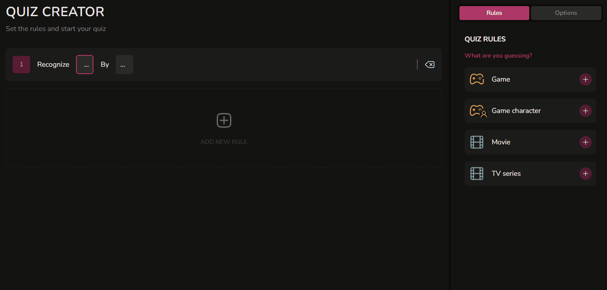
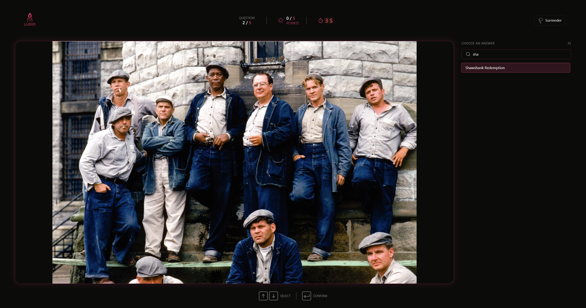

# Ludio

  

### You know it. You love it. But how well?

Ludio is a quiz platform built around a simple idea: you might know your favorite games, movies, anime, or TV shows — but can you prove it? Whether you want to test yourself, challenge a group of friends, or bring an entire Twitch community together, Ludio gives you a place to put your knowledge to the test.

Choose what you want to recognize, customize your quiz rules, and compete using a curated database of questions covering different topics — from video games to movies and beyond.

##### [**Try the Live Demo**](https://ludioquiz.duckdns.org/)

## What is Ludio?

Ludio is made for fans who think they know their favorite fictional worlds inside out. From recognizing characters and locations to identifying games, movies, or familiar sounds, every challenge puts your knowledge to the test in a different way.

What makes Ludio different is the flexibility of its quiz system. Rather than sticking to predefined question formats, you can combine different recognition types, media formats, and topic filters to shape the challenge around what interests you. Whether it's identifying a game from a screenshot, recognizing a character from a short video, or guessing something from an audio clip, there is more than one way to put your knowledge to the test.

<table>
  <tr>
    <td width="50%" valign="top">
      <h3 align="center">Customizable Quizzes</h3>
      
Combine recognition types, media formats, and topic filters to create challenges that match your interests.

    </td>
    <td width="50%" valign="top">
      <h3 align="center">Solo Gameplay</h3>
      
Test your knowledge on your own and see how well you know your favorite fictional worlds.

    </td>
  </tr>
  <tr>
    <td width="50%" valign="top">
      <h3 align="center">Dedicated Game Modes</h3>
      
Jump into quizzes focused on specific titles, or explore a wider range of topics in General Mode.

    </td>
    <td width="50%" valign="top">
      <h3 align="center">Multiple Media Formats</h3>
      
Recognize games, characters, and other content using images, video clips, or audio.

    </td>
  </tr>
  <tr>
    <td width="50%" valign="top">
      <h3 align="center">Live Multiplayer</h3>
      
Invite friends and compete together in real-time quiz sessions.

    </td>
    <td width="50%" valign="top">
      <h3 align="center">Progress and Rankings</h3>
      
Earn points, track results, and see how you compare with other players.

    </td>
  </tr>
</table>

## Built for Twitch Communities

Connecting your Twitch account unlocks additional social features in Ludio. Join communities built around your favorite streamers, connect with other viewers, and compete for a place in community rankings. Bring your community together and see who knows their favorite worlds best.

## Under the Hood

Ludio combines real-time gameplay, flexible quiz configuration, and automated content management through several custom-built systems.

**Server-Authoritative Gameplay**

The backend acts as the single source of truth for every quiz session. Redis stores the current session state, ensuring that all connected players receive consistent game updates, while MySQL handles persistent session data and final results. Answer validation and gameplay progression are handled entirely on the server, keeping game state management and question selection under server control.

**Flexible Quiz Configuration**

The quiz engine uses a combination of recognition types (_Guess Chips_), media formats (_By Chips_), and optional content filters to determine which questions match a given rule. Players can combine multiple rules and customize quiz options to create a wide variety of challenges. Questions are selected dynamically by the backend after each round, rather than being exposed to clients at the beginning of a session.

**Automated Question Management**

A custom content management script simplifies adding, updating, and removing quiz questions. Questions, answers, and media files are organized through structured JSON definitions and a categorized local media directory. A single command compares these definitions with existing database records and applies the necessary changes, eliminating the need to manage question data manually.

**Twitch Community Integration**

Twitch OAuth 2.0 connects user accounts with Ludio's social features. Streamers can create communities and share invitation links, allowing viewers to join and participate in community quizzes. Community quiz results contribute points to shared rankings, turning individual gameplay into a collective competition.

## Tech Stack

Ludio is built with a React-based frontend and a NestJS backend, supported by a relational database, Redis, and containerized deployment.

| Category                       | Technologies            |
| ------------------------------ | ----------------------- |
| **Frontend**                   | React, TypeScript, Vite |
| **State Management**           | Zustand                 |
| **Styling**                    | Tailwind CSS, SCSS      |
| **Backend**                    | NestJS, TypeScript      |
| **Database**                   | MariaDB 11, Prisma ORM  |
| **Real-time Communication**    | WebSockets              |
| **In-memory Data Store**       | Redis                   |
| **Containerization**           | Docker, Docker Compose  |
| **Web Server / Reverse Proxy** | Nginx                   |
| **Authentication**             | Twitch OAuth 2.0        |

## What's Next?

Ludio is still evolving, with several ideas planned for future development:

- **Expanded Twitch Integration** - Interactive stream overlays allowing viewers to trigger gameplay effects using Bits or Channel Points, making quizzes more unpredictable and entertaining.
- **Single-player Progression** - A campaign or achievement system featuring predefined challenges, progression mechanics, and new ways to test your knowledge.
- **More Content & Visual Improvements** - Expanding the question database with new categories and universes, alongside a complete visual redesign with custom graphics and animations.

## Author

**Patryk Olszewski**

[GitHub](https://github.com/patryk-o-dev) | [LinkedIn](https://www.linkedin.com/in/patrykodev)

Want to try Ludio together? Find me in the app using my Twitch ID: **815956724**. I'd be happy to join you for a quiz session!
